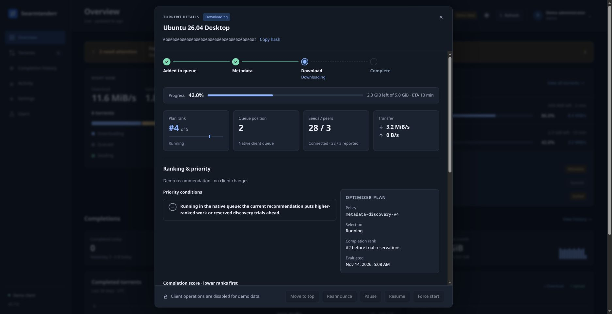

# Why is this torrent still queued?

Swarmtenderr exposes the evidence behind an automatic recommendation: native
queue position, plan rank, a weighted completion score and the conditions that
can keep a torrent waiting. Start in Observe mode while comparing its decisions
with your existing qBittorrent queue.

The examples below use the built-in synthetic demo. They explain the interface;
they are not throughput benchmarks or a claim that the example swarms exist.

## Compare the two queue positions

Open **Torrents**, select **Queued**, then inspect a transfer. **Queue position**
comes from qBittorrent. **Plan rank** is the optimizer's proposed order. They can
differ in Observe mode, during a ranking cooldown, while a trial holds a reserved
slot, or before a native priority update is confirmed. A selected slot is a plan
decision, not proof that payload is currently arriving.

## Read conditions before treating the score as a priority

The inspector explains capacity reservations, retry cooldowns, incomplete-source
evidence, low measured speed and unknown metadata. A good completion score does
not remove a capacity gate or create a free download slot. See the current
selection reason and observation time alongside the score.

Lower completion cost ranks first within the applicable evidence tiers. The base
estimate is remaining bytes divided by estimated speed. Waiting-age, completion
and remaining-size factors reduce that cost. For example, a synthetic base cost
of **750 seconds**, divided by a **1.63** remaining-size factor, produces about
**460 weighted seconds**. That value is a ranking cost, not a wall-clock ETA.
The inspector shows each factor's actual multiplier and contribution; see
[the ranking contract](ranking.md) for the complete rules and limits.

Seeders contribute to an estimated speed, but an estimate is labeled separately
from useful measured throughput. A transfer with proven recent throughput can
occupy a different evidence tier from an untested swarm. Popularity is not an
extra hidden score bonus.

## Handle missing metadata

Until metadata supplies the wanted size, the optimizer cannot calculate an
ordinary completion score. The inspector says **Not scored** rather than giving
unknown work a guessed score. A bounded metadata/discovery trial can reserve a
slot to gather evidence. Its timeline shows tracking, observed attempts,
successful acquisition, failed windows and retry eligibility.

Attempt counts begin when observation is installed. They are not the torrent's
lifetime history. An insufficiently observed window is unconfirmed, not a
demonstrated metadata failure. Increasing a retry window changes future trials;
an existing trial keeps its fixed deadline.

## Tune deliberately or act manually

Use **Settings → Optimization** to inspect ranking cadence, discovery windows,
retry delays, useful-speed thresholds and capacity reservations. Durations use
hours, minutes and seconds. Start with one change, inspect Activity and confirm
the applied revision when an external controller owns the policy.

Operators and administrators can explicitly move an unfinished download to the
top or use **Force start**. Force start bypasses qBittorrent's normal queue;
**Return to queue** hands control back. Automatic scheduling continues to exclude
forced, manually stopped, completed, seeding and keep-tagged transfers. Manual
actions are audited and uncertain upstream results are not retried automatically.

## Try this without connecting a client

Run the [synthetic Compose demo](../components/swarmtenderr/config/compose.demo.yaml)
as described in [the README](../README.md#develop-and-test). Use its queue to open
ranking details and metadata history, inspect chart tooltips and edit a setting.
The demo cannot mutate a real torrent client. To help improve installation and
explanations, submit [installation feedback](https://github.com/DEADSEC-SECURITY/swarmtenderr/issues/new?template=installation-feedback.yml).
